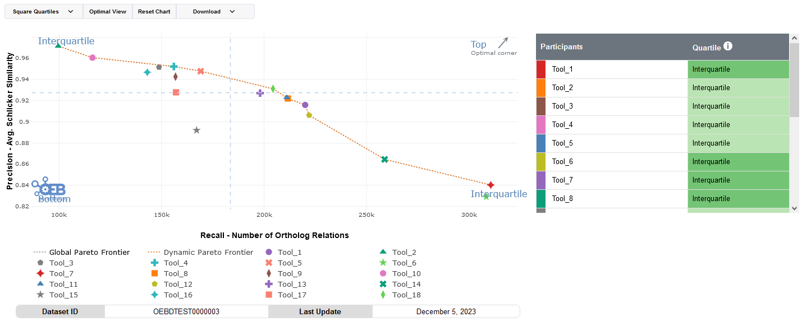
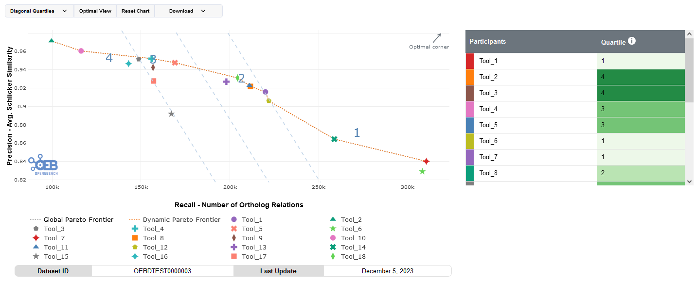
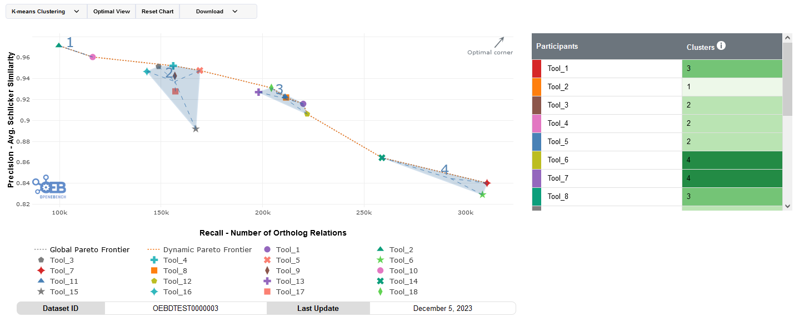
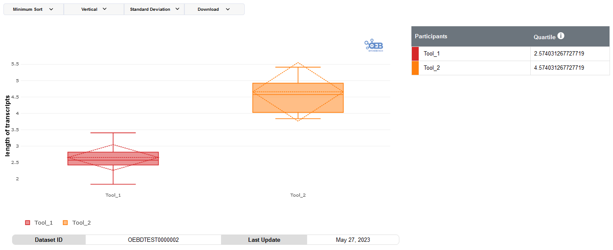
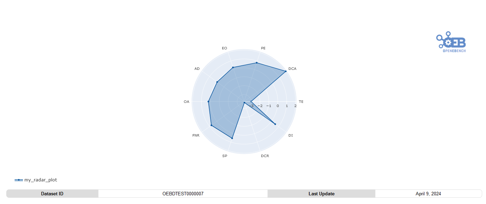

<p align="center">
  
</p>

<h1 align="center">OpenEBench Graph Widgets</h1>

<p align="center">
  Interactive benchmarking charts for <a href="https://openebench.bsc.es/">OpenEBench</a>, built with <a href="https://lit.dev/">Lit</a> and Plotly.
</p>

<p align="center">
  <a href="https://www.npmjs.com/package/@inb/oeb-widgets-graphs"></a>
  <a href="https://github.com/inab/oeb-widgets-graphs/blob/main/LICENSE"></a>
  <a href="https://nodejs.org/en/about/previous-releases"></a>
  
</p>

<p align="center">
  
</p>

## Contents

- [Contents](#contents)
- [Documentation and examples](#documentation-and-examples)
- [Requirements and dependencies](#requirements-and-dependencies)
- [Development](#development)
- [Documentation](#documentation)
- [Project structure](#project-structure)
- [Usage](#usage)
- [Plot types](#plot-types)
  - [Bar plot](#bar-plot)
    - [Bar plot classification](#bar-plot-classification)
    - [Bar plot structure](#bar-plot-structure)
  - [Scatter plot](#scatter-plot)
    - [Scatter plot classification](#scatter-plot-classification)
    - [Scatter plot structure](#scatter-plot-structure)
  - [Box plot](#box-plot)
    - [Box plot classification](#box-plot-classification)
    - [Box plot structure](#box-plot-structure)
  - [Radar plot](#radar-plot)
    - [Radar plot structure](#radar-plot-structure)

## Documentation and examples

- [Full documentation and live demos](https://inab.github.io/oeb-widgets-graphs/)
- [Example applications](https://github.com/inab/demo_oeb-widgets-graphs)

## Requirements and dependencies

For development and builds, use a supported Node.js LTS release. Node.js **26 LTS**
is recommended and pinned in `.nvmrc`. The build has also been tested with
Node.js 24. Vite accepts Node.js 20.19+ or 22.12+, but Node.js 20 is
end-of-life and is not recommended.

The main dependencies and their declared version ranges are:

| Dependency | Version range | Purpose |
| --- | --- | --- |
| [Lit](https://lit.dev/) | `^3.3.3` | Web components |
| [Plotly.js](https://plotly.com/javascript/) | `^4.3.0` | Chart rendering |
| [D3](https://d3js.org/) | `^7.9.2` | Data visualization utilities |
| [Bootstrap](https://getbootstrap.com/) | `^5.3.9` | UI styles |
| [jsPDF](https://github.com/parallax/jsPDF) | `^4.2.1` | PDF export |
| [jsPDF-AutoTable](https://github.com/simonbengtsson/jsPDF-AutoTable) | `^5.0.9` | Tables in PDF exports |
| [html2canvas](https://html2canvas.hertzen.com/) | `^1.4.1` | HTML capture for exports |
| [simple-statistics](https://simple-statistics.github.io/) | `^8.0.0` | Statistical calculations |
| [pareto-frontier](https://www.npmjs.com/package/pareto-frontier) | `^1.1.1` | Pareto frontier calculations |
| [Vite](https://vite.dev/) | `^8.3.8` | Development server and build tool |

These are ranges, not exact installed versions. See
[`package.json`](https://github.com/inab/oeb-widgets-graphs/blob/main/package.json)
for all dependencies and
[`package-lock.json`](https://github.com/inab/oeb-widgets-graphs/blob/main/package-lock.json)
for the locked versions.

## Development

Install the Node.js version from `.nvmrc` with [nvm](https://github.com/nvm-sh/nvm), if using it:

```sh
nvm install
nvm use
```

Install dependencies and start the development server:

```sh
npm ci
npm run dev
```

Build the distributable package:

```sh
npm run build
```

## Documentation
The package is build with [Lint Elements](https://lit.dev/) components and javascript modules.

It has some dependencies associated for the functionalities:
* *html2canvas*
* *jspdf*
* *pareto-frontier*
* *simple-statistics*
* *plotly.js*

- - - -
## Project structure
* /src. Where the main application files are hosted.
* /src/demo. Live demo of applications functionalities and a .json file to simulate real data.

- - - -
## Usage
```
import '@inb/oeb-widgets-graphs/dist/oeb-widgets-graphs.es.js';
```

Then just declare the element with the variables that contain the data to be able to build the corresponding graph.
```
<widget-element
  :data=graphData
  :type=graphType>
</widget-element>
```

## Plot types

### Bar plot
Bar plot shows the results of a benchmarking challenge that uses one single evaluation metric in the form of a Barplot. Challenge participants are shown in the X axis, while the value of their metric is shown in the Y axis.
#### Bar plot classification
The results of this plot format can be transformed into a tabular format by sorting the participants in descending/ascending order according to their metrics and applying a quartile classification over that linear set of values. This classification splits the participants into four different groups/clusters depending on their performance. Clusters are separated in the plot with vertical lines and shown in the right table together with a green color-scale, which is easier to interpret for both experts and non-expert users.

#### Bar plot structure
You can see an example of a structure to display bar graphs within the "demo" section of the application. [Bar plot example](https://github.com/inab/oeb-widgets-graphs/blob/main/src/demo/files/BARPLOT.json)   
- - - -
### Scatter plot
Scatter plot displays the results of scientific benchmarking experiments in graph format, and apply various classification methods to transform them to tabular format.
#### Scatter plot classification
* Square quartiles - divide the plotting area in four squares by getting the 2nd quartile of the X and Y metrics.



* Diagonal quartiles - divide the plotting area with diagonal lines by assigning a score to each participant based in the distance to the 'optimal performance'.



* Clustering - group the participants using the K-means clustering algorithm and sort the clusters according to the performance.


#### Scatter plot structure
You can see an example of a structure to display bar graphs within the "demo" section of the application. [Scatter plot example](https://github.com/inab/oeb-widgets-graphs/blob/main/src/demo/files/SCATTERPLOT.json) 
- - - -
### Box plot
Box plot shiw the results of a benchmarking challenge that uses a graphical representation of the distribution of a dataset on a seven-number summary of datapoints. The challenge metrics is represented in Y axis by default.
#### Box plot classification
The result of the plot can be ordened by maximum or minimum median value.

#### Box plot structure
You can see an example of a structure to display bar graphs within the "demo" section of the application. [Box plot example](https://github.com/inab/oeb-widgets-graphs/blob/main/src/demo/files/BOXPLOT.json) 

### Radar plot
A radar chart is an informative visual tool in which multiple variables (three or more) are compared on a two-dimensional plane. To do this, we will create different axes that come from a common central point. In most cases, all axes are evenly distributed and drawn evenly relative to each other.

#### Radar plot structure
You can see an example of a structure to display bar graphs within the "demo" section of the application. [Radar plot example](https://github.com/inab/oeb-widgets-graphs/blob/main/src/demo/files/RADARPLOT.json)