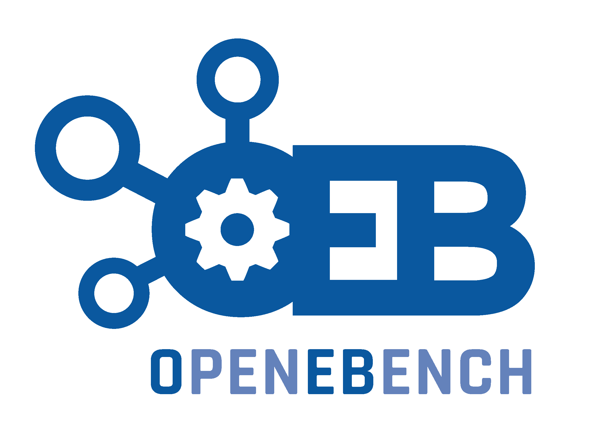
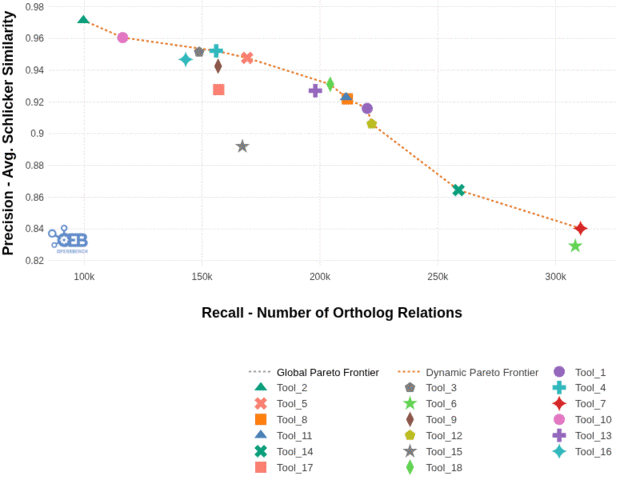
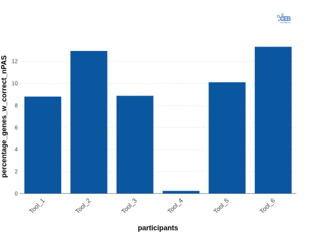
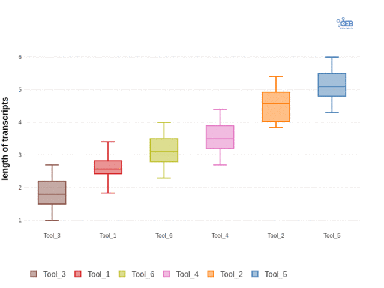
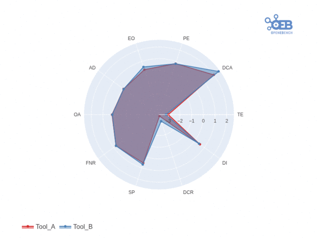
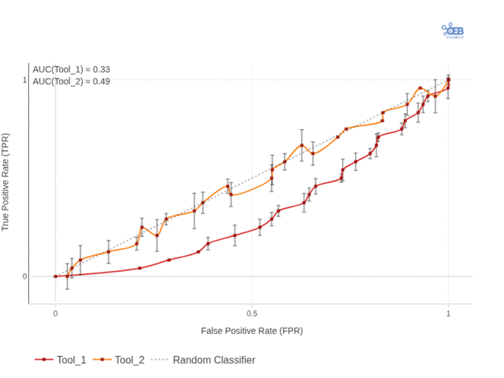

<p align="center">
  
</p>

<h1 align="center">OpenEBench Graph Widgets</h1>

<p align="center">
  Interactive benchmarking charts for <a href="https://openebench.bsc.es/">OpenEBench</a>, built with <a href="https://lit.dev/">Lit</a> and Plotly.
</p>

<p align="center">
  <a href="https://www.npmjs.com/package/@inb/oeb-widgets-graphs"></a>
  <a href="https://github.com/inab/oeb-widgets-graphs/blob/main/LICENSE"></a>
  <a href="https://nodejs.org/en/about/previous-releases"></a>
  
</p>

<p align="center">
  
</p>

## Contents

- [Documentation and examples](#documentation-and-examples)
- [Requirements and dependencies](#requirements-and-dependencies)
- [Development](#development)
- [Usage](#usage)
- [Plot types](#plot-types)
  - [Bar plot](#bar-plot)
  - [Scatter plot](#scatter-plot)
  - [Box plot](#box-plot)
  - [Radar plot](#radar-plot)
  - [Line plot](#line-plot)
- [Documentation and GitHub Pages](#documentation-and-github-pages)
- [Project structure](#project-structure)

## Documentation and examples

- [Documentation and interactive examples](https://inab.github.io/oeb-widgets-graphs/)
- [npm package](https://www.npmjs.com/package/@inb/oeb-widgets-graphs)
- [Example applications](https://github.com/inab/demo_oeb-widgets-graphs)

## Requirements and dependencies

For development and builds, use a supported Node.js LTS release. Node.js
**26 LTS** is recommended and pinned in `.nvmrc`; the build has also been
tested with Node.js 24.

| Dependency | Version range | Purpose |
| --- | --- | --- |
| [Lit](https://lit.dev/) | `^3.3.3` | Web components |
| [Plotly.js](https://plotly.com/javascript/) | `^4.3.0` | Chart rendering |
| [D3](https://d3js.org/) | `^7.9.2` | Data visualization utilities |
| [Bootstrap](https://getbootstrap.com/) | `^5.3.9` | UI styles |
| [jsPDF](https://github.com/parallax/jsPDF) | `^4.2.1` | PDF export |
| [jsPDF-AutoTable](https://github.com/simonbengtsson/jsPDF-AutoTable) | `^5.0.9` | Tables in PDF exports |
| [html2canvas](https://html2canvas.hertzen.com/) | `^1.4.1` | HTML capture for exports |
| [simple-statistics](https://simple-statistics.github.io/) | `^8.0.0` | Statistical calculations |
| [pareto-frontier](https://www.npmjs.com/package/pareto-frontier) | `^1.1.1` | Pareto frontier calculations |
| [Vite](https://vite.dev/) | `^8.3.8` | Development server and build tool |

These are declared ranges; see `package-lock.json` for locked versions.

## Development

Use the Node.js version in `.nvmrc`, then install and run the demo:

```sh
nvm install
nvm use
npm ci
npm run dev
```

The demo opens at `/src/demo/index.html`. Its plot and sample selectors cover
the examples listed below. Run the focused statistics tests with
`node --test tests/line-statistics.test.js`.

```sh
npm run build
```

The build produces the package in `dist` and copies this README into it.
Changing the source version does not publish a new npm release.

## Usage

Install the package:

```sh
npm install @inb/oeb-widgets-graphs
```

In an application using a bundler, import the package and provide the data:

```html
<widget-element id="benchmark"></widget-element>

<script type="module">
  import '@inb/oeb-widgets-graphs';

  const response = await fetch('/path/to/BARPLOT.json');
  if (!response.ok) throw new Error('Failed to load benchmark data');
  const graphData = await response.json();
  const widget = document.getElementById('benchmark');
  widget.type = 'bar-plot';
  widget.data = JSON.stringify(graphData);
</script>
```

Use `bar-plot`, `2D-plot` (scatter), `box-plot`, `radar-plot`, or `line-plot`
as the widget type. The sample JSON files show the data structure for each
plot; radar and line use metric-series representations.

## Plot types

### Bar plot

Compare one metric across participants. Sort and classify by quartiles, reverse
the order, switch between Original and Optimal axis ranges, or download the
result. Optimization determines whether lower or higher values rank first.

Samples: [default](https://github.com/inab/oeb-widgets-graphs/blob/main/src/demo/files/BARPLOT.json),
[mixed signs](https://github.com/inab/oeb-widgets-graphs/blob/main/src/demo/files/BARPLOT_NEGATIVE_MIXED.json),
[all negative](https://github.com/inab/oeb-widgets-graphs/blob/main/src/demo/files/BARPLOT_NEGATIVE_ALL.json),
[minimize](https://github.com/inab/oeb-widgets-graphs/blob/main/src/demo/files/BARPLOT_MINIMIZE.json).

[Live demo](https://inab.github.io/oeb-widgets-graphs/_examples/barplot.html)



### Scatter plot

Compare two metrics using square quartiles, diagonal quartiles or K-means.
The optimal corner follows the metrics' optimization directions. Select
participants in the legend or table; at least one must remain visible, or
four for K-means. Original and Optimal change the axis range without changing
the selection. The table stacks below the chart in narrow layouts, and the
legend scrolls when necessary.

Samples: [top-right](https://github.com/inab/oeb-widgets-graphs/blob/main/src/demo/files/SCATTERPLOT.json),
[top-left](https://github.com/inab/oeb-widgets-graphs/blob/main/src/demo/files/SCATTERPLOT_TOP_LEFT.json),
[bottom-right](https://github.com/inab/oeb-widgets-graphs/blob/main/src/demo/files/SCATTERPLOT_BOTTOM_RIGHT.json),
[bottom-left](https://github.com/inab/oeb-widgets-graphs/blob/main/src/demo/files/SCATTERPLOT_BOTTOM_LEFT.json),
[negative values](https://github.com/inab/oeb-widgets-graphs/blob/main/src/demo/files/SCATTERPLOT_NEGATIVE.json).

[Live demo](https://inab.github.io/oeb-widgets-graphs/_examples/scatterplot.html)


### Box plot

Compare distributions and sort participants by median. Change orientation and
graph style, or select participants in the legend or table. Hidden rows show
`--`; at least one participant must remain visible. Table and hover values use
five decimal places.

Samples: [minimum](https://github.com/inab/oeb-widgets-graphs/blob/main/src/demo/files/BOXPLOT.json),
[maximum](https://github.com/inab/oeb-widgets-graphs/blob/main/src/demo/files/BOXPLOT_MAXIMIZE.json),
[no optimization](https://github.com/inab/oeb-widgets-graphs/blob/main/src/demo/files/BOXPLOT_NO_OPTIMIZATION.json),
[negative values](https://github.com/inab/oeb-widgets-graphs/blob/main/src/demo/files/BOXPLOT_NEGATIVE.json).

[Live demo](https://inab.github.io/oeb-widgets-graphs/_examples/boxplot.html)



### Radar plot

Compare multiple metrics and use the legend to show or hide participants.
Metrics with a declared scale are normalized per axis to 0–1, respecting
optimization direction; hover shows the original values. Normalization does
not make different units directly comparable.

Samples: [standard](https://github.com/inab/oeb-widgets-graphs/blob/main/src/demo/files/RADARPLOT.json),
[synthetic technical metrics](https://github.com/inab/oeb-widgets-graphs/blob/main/src/demo/files/RADARPLOT_TECHNICAL.json).

[Live demo](https://inab.github.io/oeb-widgets-graphs/_examples/radarplot.html)



### Line plot

Show participant curves and use the legend to hide or show them; at least one
must remain visible. Quartiles and Average compare areas under curves over the
shared X range. Q1 is best according to Y-axis optimization, and the legend
and table show each classification. The IQR view summarizes pooled X and Y
values. Statistics include hidden participants.

The ROC example includes a random-classifier diagonal as a chance baseline,
excluded from statistics. No baseline is added to the precision–recall
example.

Samples: [ROC](https://github.com/inab/oeb-widgets-graphs/blob/main/src/demo/files/LINEPLOT.json),
[precision–recall](https://github.com/inab/oeb-widgets-graphs/blob/main/src/demo/files/LINEPLOT_PRECISION_RECALL.json).

[Live demo](https://inab.github.io/oeb-widgets-graphs/_examples/lineplot.html)



## Documentation and GitHub Pages

The Jekyll site is in the `docs` folder on the `docs` branch. From that
branch, preview it locally with Ruby and Bundler:

```sh
cd docs
bundle install
bundle exec jekyll serve
```

The interactive documentation loads the widget bundle and sample JSON from
the public GitHub revision pinned as `demo_revision` in `docs/_config.yml`.
Each plot page includes a runnable HTML usage example with the selected
sample JSON inline and a link to that JSON, which opens in a new tab.
Use the copy buttons to copy documentation snippets to the clipboard.
Update that revision after the desired bundle and samples are published to
GitHub; the examples do not depend on the npm release. Browsers need access
to jsDelivr to load them.

For branch-based deployment, set **Settings → Pages → Build and deployment**
to **Deploy from a branch**, select the `docs` branch and the `/docs` folder,
then save. Push committed documentation changes to that branch to trigger a
build; check the Pages deployment in the repository's **Actions** tab.
The site uses the checked-in Prism assets and does not need a custom Jekyll
plugin or deployment workflow.
See [GitHub's publishing source guide](https://docs.github.com/en/pages/getting-started-with-github-pages/configuring-a-publishing-source-for-your-github-pages-site).

## Project structure

- `src/`: widget components and shared styles.
- `src/demo/`: local demo and example JSON data.
- `dist/`: built distributable package.
- `docs/`: documentation site on the `docs` branch.

## License

[Apache License 2.0](LICENSE).
