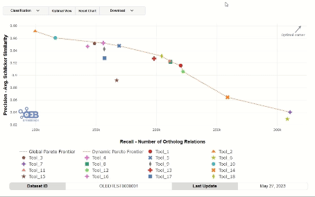
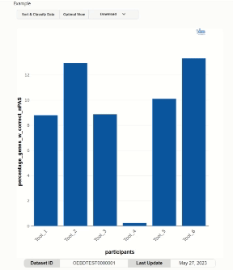
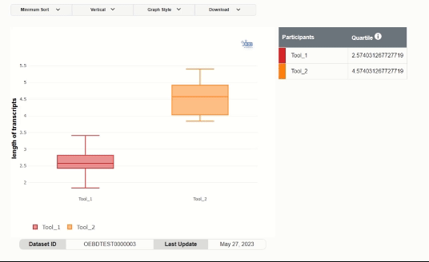
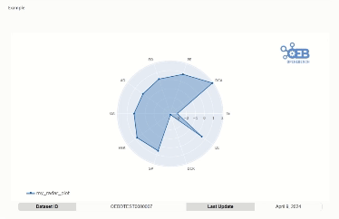
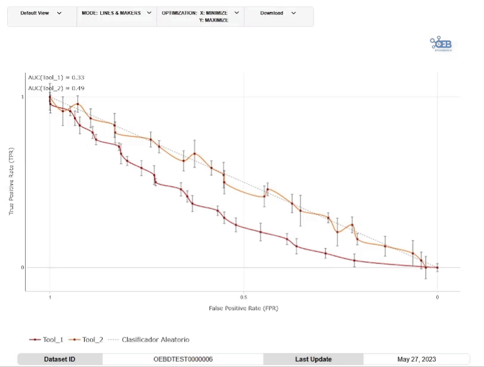

<p align="center">
  
</p>

<h1 align="center">OpenEBench Graph Widgets</h1>

<p align="center">
  Interactive benchmarking charts for <a href="https://openebench.bsc.es/">OpenEBench</a>, built with <a href="https://lit.dev/">Lit</a> and Plotly.
</p>

<p align="center">
  <a href="https://www.npmjs.com/package/@inb/oeb-widgets-graphs"></a>
  <a href="https://github.com/inab/oeb-widgets-graphs/blob/main/LICENSE"></a>
  <a href="https://nodejs.org/en/about/previous-releases"></a>
  
</p>

<p align="center">
  
</p>

## Contents

- [Documentation and examples](#documentation-and-examples)
- [Requirements and dependencies](#requirements-and-dependencies)
- [Development](#development)
- [Usage](#usage)
- [Plot types](#plot-types)
  - [Bar plot](#bar-plot)
  - [Scatter plot](#scatter-plot)
  - [Box plot](#box-plot)
  - [Radar plot](#radar-plot)
  - [Line plot](#line-plot)
- [Project structure](#project-structure)

## Documentation and examples

- [Full documentation and live demos](https://inab.github.io/oeb-widgets-graphs/)
- [Example applications](https://github.com/inab/demo_oeb-widgets-graphs)

## Requirements and dependencies

For development and builds, use a supported Node.js LTS release. Node.js **26 LTS**
is recommended and pinned in `.nvmrc`. The build has also been tested with
Node.js 24. Vite accepts Node.js 20.19+ or 22.12+, but Node.js 20 is
end-of-life and is not recommended.

The main dependencies and their declared version ranges are:

| Dependency | Version range | Purpose |
| --- | --- | --- |
| [Lit](https://lit.dev/) | `^3.3.3` | Web components |
| [Plotly.js](https://plotly.com/javascript/) | `^4.3.0` | Chart rendering |
| [D3](https://d3js.org/) | `^7.9.2` | Data visualization utilities |
| [Bootstrap](https://getbootstrap.com/) | `^5.3.9` | UI styles |
| [jsPDF](https://github.com/parallax/jsPDF) | `^4.2.1` | PDF export |
| [jsPDF-AutoTable](https://github.com/simonbengtsson/jsPDF-AutoTable) | `^5.0.9` | Tables in PDF exports |
| [html2canvas](https://html2canvas.hertzen.com/) | `^1.4.1` | HTML capture for exports |
| [simple-statistics](https://simple-statistics.github.io/) | `^8.0.0` | Statistical calculations |
| [pareto-frontier](https://www.npmjs.com/package/pareto-frontier) | `^1.1.1` | Pareto frontier calculations |
| [Vite](https://vite.dev/) | `^8.3.8` | Development server and build tool |

These are ranges, not exact installed versions. See
[`package.json`](https://github.com/inab/oeb-widgets-graphs/blob/main/package.json)
for all dependencies and
[`package-lock.json`](https://github.com/inab/oeb-widgets-graphs/blob/main/package-lock.json)
for the locked versions.

## Development

Install the Node.js version from `.nvmrc` with [nvm](https://github.com/nvm-sh/nvm), if using it:

```sh
nvm install
nvm use
```

Install dependencies and start the development server:

```sh
npm ci
npm run dev
```

Build the distributable package:

```sh
npm run build
```

The build writes the package to `dist/` and copies this README into it.
See the [demo source](https://github.com/inab/oeb-widgets-graphs/tree/main/src/demo)
for sample data and local development examples.

## Usage

Install the package:

```sh
npm install @inb/oeb-widgets-graphs
```

Import it and provide the widget type and JSON data:

```html
<widget-element id="benchmark"></widget-element>

<script type="module">
  import '@inb/oeb-widgets-graphs';

  const response = await fetch('/path/to/BARPLOT.json');
  if (!response.ok) throw new Error('Failed to load benchmark data');
  const graphData = await response.json();
  const widget = document.querySelector('#benchmark');
  widget.setAttribute('type', 'bar-plot');
  widget.setAttribute('data', JSON.stringify(graphData));
</script>
```

The supported types are `bar-plot`, `2D-plot` (scatter), `box-plot`,
`radar-plot` and `line-plot`. Each type expects its corresponding data
structure; examples are linked below.

Alternatively, a built UMD bundle can be loaded directly:

```html
<script src="https://cdn.jsdelivr.net/gh/inab/oeb-widgets-graphs@main/dist/oeb-widgets-graphs.umd.js"></script>
```

## Plot types

### Bar plot

Compares participants using one metric. Results can be sorted and classified
into quartiles, shown alongside the chart in a table.

[Live demo](https://inab.github.io/oeb-widgets-graphs/_examples/barplot.html) |
[Example data](https://github.com/inab/oeb-widgets-graphs/blob/main/src/demo/files/BARPLOT.json)



### Scatter plot

Compares participants on two metrics. Available classifications include square
quartiles, diagonal quartiles based on distance from the optimal corner, and
K-means clustering.

[Live demo](https://inab.github.io/oeb-widgets-graphs/_examples/scatterplot.html) |
[Example data](https://github.com/inab/oeb-widgets-graphs/blob/main/src/demo/files/SCATTERPLOT.json)


### Box plot

Shows the distribution of each participant's metric using summary statistics.
Participants can be ordered by minimum or maximum median value.

[Live demo](https://inab.github.io/oeb-widgets-graphs/_examples/boxplot.html) |
[Example data](https://github.com/inab/oeb-widgets-graphs/blob/main/src/demo/files/BOXPLOT.json)



### Radar plot

Compares multiple metrics on axes radiating from a common center, with one
trace per tool. Values are not normalized across metrics; metrics with different
scales or units should be interpreted with care. Metrics marked for
minimization are plotted with their values negated.

[Live demo](https://inab.github.io/oeb-widgets-graphs/_examples/radarplot.html) |
[Example data](https://github.com/inab/oeb-widgets-graphs/blob/main/src/demo/files/RADARPLOT.json)



### Line plot

Displays relationships between numerical variables with connected data points,
allowing trends and multiple datasets to be compared.

[Live demo](https://inab.github.io/oeb-widgets-graphs/_examples/lineplot.html) |
[Example data](https://github.com/inab/oeb-widgets-graphs/blob/main/src/demo/files/LINEPLOT.json)



## Project structure

- `src/`: widget components and shared styles.
- `src/demo/`: local demo and example JSON data.
- `dist/`: built distributable package.
